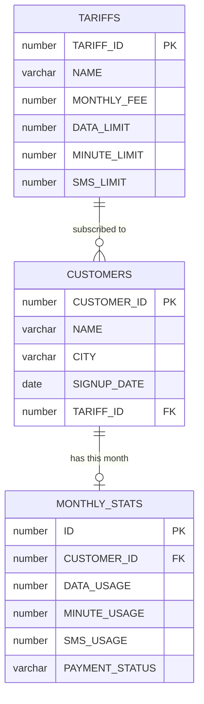

# Telco Analytics — Oracle SQL

Analysis of a telecom operator's customer, tariff and monthly-usage data in **Oracle XE**:
schema design with constraints and indexes, automated seeding with Docker Compose, and
commented SQL answers to twelve business questions (i2i Systems database assignment).

## Data

| Table | Rows | Contents |
|---|---|---|
| `TARIFFS` | 4 | Tariff name, monthly fee and data / minute / SMS limits |
| `CUSTOMERS` | 10,000 | Customer, city, signup date, subscribed tariff |
| `MONTHLY_STATS` | 9,950 | This month's data, minute and SMS usage plus payment status |

`MONTHLY_STATS` has fewer rows than `CUSTOMERS` on purpose: some monthly records were "lost",
and finding them is one of the questions.



Indexes cover the columns the queries filter and join on: tariff, city, signup date and payment status.

## Run it

```bash
docker compose up -d
```

Oracle XE starts on port `1521` and `TABLE_CREATION_SCRIPTS.sql` runs automatically on first boot.
Import the three CSV files (for example with DBeaver's CSV import, date format `DD/MM/YYYY`),
then run the queries in `SOLUTIONS.sql`.

## Questions answered

Every query in [`SOLUTIONS.sql`](SOLUTIONS.sql) is preceded by a comment explaining the approach.

| # | Question | Technique |
|---|---|---|
| 1.1 | Customers on the *Kobiye Destek* tariff | `JOIN` on tariff name |
| 1.2 | Newest customer on that tariff | `FETCH FIRST 1 ROW WITH TIES` |
| 2.1 | Tariff distribution with percentages | `LEFT JOIN` + `SUM(COUNT(*)) OVER ()` |
| 3.1 | Earliest customers to sign up | order by signup date, not by ID |
| 3.2 | Their distribution across cities | same filter, `GROUP BY city` |
| 4.1 | Customers with a missing monthly record | anti-join (`LEFT JOIN … IS NULL`) |
| 4.2 | Missing records by city | anti-join + `GROUP BY` |
| 5.1 | Used at least 75% of the data limit | usage ÷ limit, zero-limit tariffs excluded |
| 5.2 | Exhausted every package limit | all three limits reached, zero limits excluded |
| 6.1 | Customers with unpaid fees | three-table join, with the fee owed |
| 6.2 | Payment status by tariff | `GROUP BY` + `SUM(COUNT(*)) OVER (PARTITION BY tariff)` |

## Files

```
TABLE_CREATION_SCRIPTS.sql   schema, constraints, indexes
SOLUTIONS.sql                commented answers
docker-compose.yml           Oracle XE with automatic schema creation
*.csv                        source data
```
